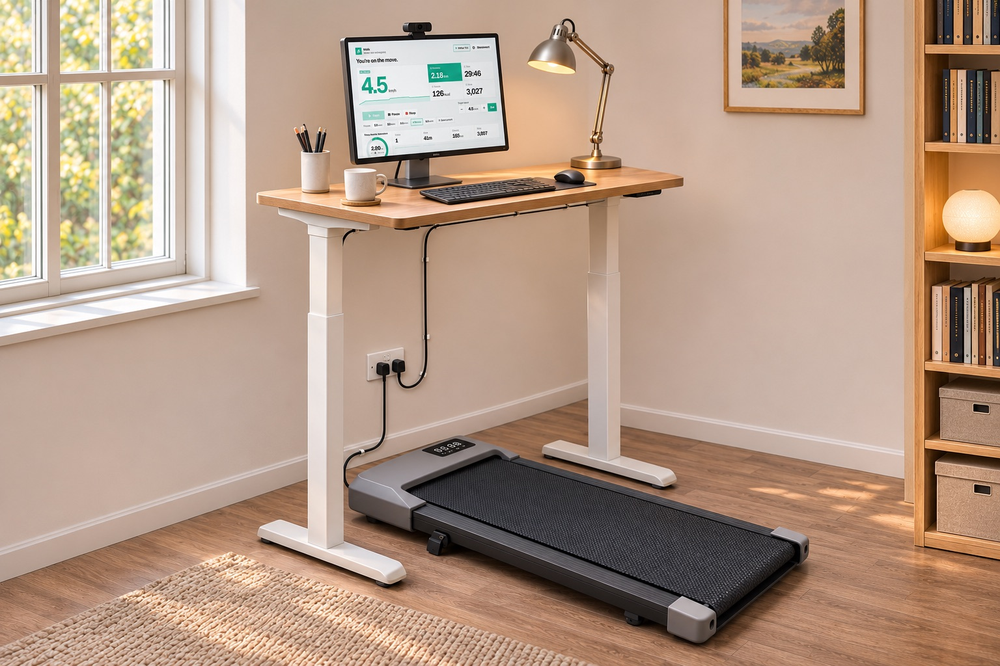
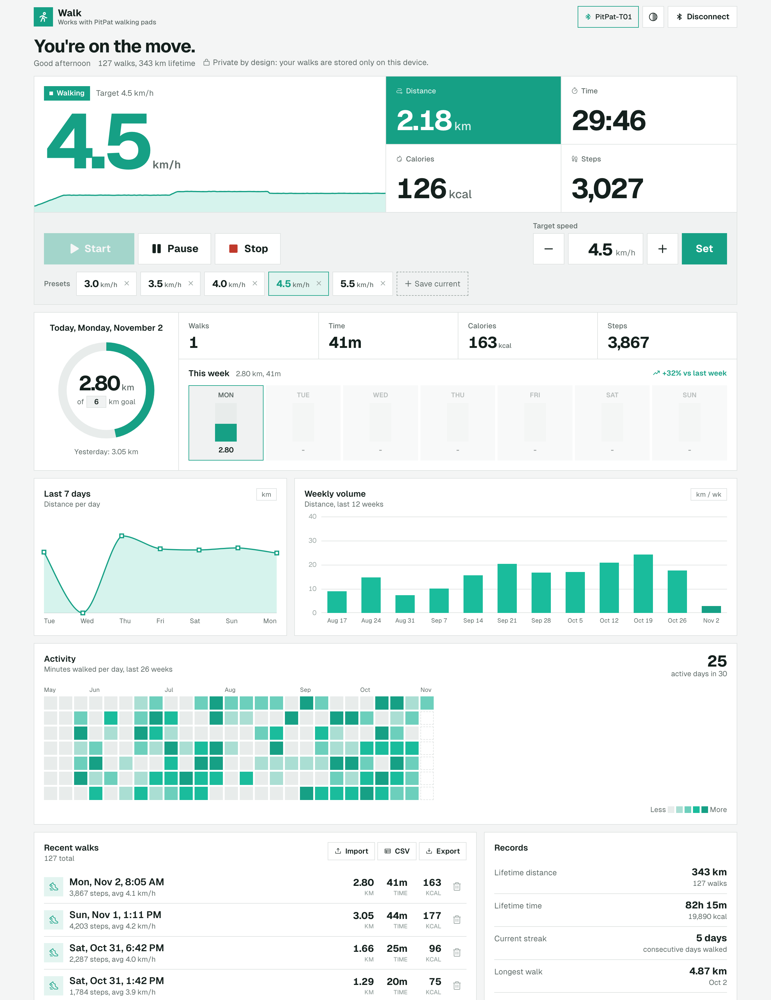

# Walk

**Control your walking pad from the browser. Works with Superun, DeerRun and other PitPat walking pads, no PitPat app needed.**



**Try it: [walk.omrilotan.com/app](https://walk.omrilotan.com/app/)** · [About Walk](https://walk.omrilotan.com/)

Open the page, press Connect, and walk. Start, pause, stop and set your speed with one tap, and see every walk you've taken. Nothing to install and no account needed. Your walks stay on your device unless you choose to sync them.

<p align="center">
	
	
</p>

## Why Walk

- **Private by design.** Your walks are stored on your device. An account is optional, only to sync between browsers and connect an assistant. No analytics, no tracking.
- **Instant.** No app store, no sign-up needed. It runs in your browser.
- **Works offline.** Install it from your browser, on a computer or phone, and it runs the pad without internet.
- **Controls first.** Big Start, Pause and Stop buttons, an exact speed setting, one-tap presets and keyboard shortcuts.
- **Every step counted.** Speed, distance, time, steps and calories for every walk, kept safe through pauses and dropped connections.
- **See your progress.** A daily goal, your week at a glance, weekly trends, an activity calendar and personal records.
- **Your data is yours.** Export a backup or a spreadsheet anytime, import it elsewhere, or reset everything. All from the menu.
- **Connect your AI agent.** Claude, ChatGPT and others can follow your walks from anywhere (remote MCP). An assistant in your browser can also help run the pad (WebMCP), with you in charge of starting it.
- **Light and dark.** Follows your device, or pick one.
- **Free and open source.**

## On a bigger screen

Everything at a glance: the live walk and controls up top, then today's goal, your week, weekly trends, a six-month activity calendar, recent walks and personal records.



## What you need

- A Superun, DeerRun or other walking pad that uses the PitPat app.
- **Chrome, Edge or Opera** on a computer or an Android phone.

Not supported: iPhone and iPad, Safari, and Firefox. These browsers don't allow websites to use Bluetooth.

## How to use

1. Turn on the pad and close the PitPat phone app. The pad connects to one device at a time.
2. Open [walk.omrilotan.com/app](https://walk.omrilotan.com/app/) and press **Connect**.
3. Pick your pad from the list.
4. Press **Start**, or tap a preset speed. The belt ramps up to your target speed.

Keyboard: <kbd>Space</kbd> start or pause, <kbd>↑</kbd> <kbd>↓</kbd> change speed, <kbd>Esc</kbd> stop.

## Use it with an AI agent

Walk supports [WebMCP](https://developer.chrome.com/docs/ai/webmcp/imperative-api), a new web standard that lets a page offer its features to an AI agent running in the same browser. The agent calls Walk's own controls directly, rather than guessing at buttons on the screen.

### A walk with an agent

![A six-panel stick-figure comic of a walk with an AI agent. 10:40: "Walk me while I clear email. Easy pace." The laptop asks "Start at 3.0 km/h?" Walk asks first: the screen reads "An agent wants to start the belt at 3.0 km/h" and the walker taps Allow. 11:00: the phone rings, "Pause for the call." "Paused." 12:32: the laptop asks "400 m to your goal. Eight more minutes?" and the walker answers "Keep going." 12:40: arms up, "Stop." "Stopped. 5.0 km, saved." Friday, coffee in hand: the laptop asks "Your goal was hit every day this week. Raise it to 6?" and the walker answers "Nope."](public/images/agent-comic.jpg)

<details>
<summary>Read the story as text</summary>

It's 10:40. The pad is under the standing desk and Walk is open and connected. You type to the browser's assistant: *"Walk me while I clear email. Easy pace."*

The assistant checks the pad (connected, stopped) and your goal (5 km). It suggests 3 km/h, and a bar appears in Walk: **"An agent wants to start the belt at 3.0 km/h. Allow / Deny."** You tap Allow and the belt starts.

At 11:00, 1 km in, a call comes in. *"Pause for the call."* The belt pauses at once, no questions asked. The call ends at 11:20: *"Back on."* The assistant asks to resume at 3 km/h, you tap Allow, and you're walking again.

At 12:32 you're at 4.6 km: *"400 m to your goal. Eight more minutes?"* You keep going. At 12:40 you hit 5 km. *"Stop."* The belt stops, and the walk is saved to your history like any other.

On Friday the assistant sums up the week: *"Your goal was hit every day this week. Raise it to 6?"* That's a settings change, so it asks, and you say no.

</details>

The agent works **for** you on the reading, summing up and timing. It works **with** you on anything that moves you: you decide when the belt starts.

### What an agent can do

- Read the pad's status, today's progress toward your goal, your week, records and recent walks.
- Pause and stop the belt. These always work right away.
- Change speed while you walk, by at most 1 km/h per step.
- Start or resume the belt. Walk asks first with **Allow**, **Always allow** or **Deny**, and waits up to a minute for your tap. Change it any time in Menu, Connect your AI agent.
- Change your daily goal.

An agent cannot connect the pad; you press Connect yourself. What the assistant does with what it reads is up to the assistant you use.

WebMCP is new and available in Chrome only. In other browsers the agent option doesn't appear and Walk works as before.

### Connect from anywhere (remote MCP)

With cloud sync on (sign in from the menu), your walks also reach assistants that are not in your browser. Remote MCP reads synced walks only, so it needs sync; WebMCP above needs no account. Add `https://walk.omrilotan.com/mcp` as a connector in Claude, ChatGPT or any assistant that supports remote MCP servers. It sends you to Walk to sign in and approve, then it can:

- `get_summary`: today, your goal and progress, this week against last week, streak, records and your last walk.
- `get_daily_totals`: day by day, with whether you met your goal.
- `get_walks`: individual walks, optionally between two dates.
- `set_goal`: change your daily goal, only if you allowed it when connecting.

It reads walks Walk has synced, so a walk shows up when it ends. It cannot start or stop the pad. See and disconnect your assistants in Walk, under Menu, Sync and assistants.

## Your data

Your walks are saved in your browser on this device. Clearing your browser's site data deletes them, so use **Export backup** in the menu now and then. **Import** brings a backup back, on this device or another one. **Reset my data** deletes every walk.

An account is optional. Sign in from the menu with your email (we send a code; no password, and the page never reloads, so the pad stays connected) and Walk syncs your walk totals between your browsers: start and end time, distance, time, steps, calories and top speed. Per-second readings stay in the browser. Deleting your account removes your email address and every synced walk from the server, and disconnects your assistants. Only what sync needs is stored, nothing is logged, and you can download it all from the menu. See the [privacy notice](https://walk.omrilotan.com/privacy/) and [terms](https://walk.omrilotan.com/terms/).

## Run it yourself

Walk is a static site in `public/` plus one Cloudflare Worker in `src/` for sign-in, sync and the MCP server.

```sh
npm i
cp .dev.vars.example .dev.vars   # local settings: sign-in codes are returned instead of emailed
npm run migrate:local
npx wrangler dev --port 8787 --local-upstream localhost:8787
```

To deploy your own: create a D1 database (`wrangler d1 create walk --jurisdiction eu` keeps it in the EU) and a KV namespace, put their IDs and your domain in `wrangler.jsonc`, onboard your sending domain to Cloudflare Email Sending, then `npm run migrate` and `npm run deploy`. Nothing secret lives in this repository; resource IDs are useless without access to the Cloudflare account.

## Safety

Walk controls moving equipment. Keep the pad's remote within reach and step off before starting or changing speed while testing. Use at your own risk.

## Thanks

Built on the protocol work of [PitPat-WebBT](https://github.com/KeiranY/PitPat-WebBT), [pitpat-treadmill](https://github.com/Razzolate99/pitpat-treadmill) and [pacekeeper](https://github.com/peteh/pacekeeper).

## Disclaimer

Walk is an independent project, not affiliated with or endorsed by PitPat, Superun or DeerRun. These are trademarks of their respective owners, used only to describe compatibility.

## License

Public domain, under [The Unlicense](LICENSE).
